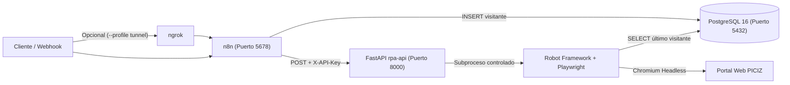

<div align="center">

# PICIZ RPA Automation Platform

**Plataforma contenerizada de Automatización Robótica de Procesos (RPA) de grado productivo para el registro automatizado de visitantes en el portal empresarial PICIZ.**

[](https://github.com/Sev-AS/piciz-rpa-automation-platform/actions/workflows/ci.yml)


[](LICENSE)

</div>

---

## Contexto y Retos Técnicos Resueltos

El registro manual de visitantes en portales empresariales heredados (como **PICIZ**, basado en AngularJS) suele ser lento, propenso a errores humanos y difícil de integrar porque no expone una API pública.

Esta plataforma resuelve el problema de extremo a extremo mediante una arquitectura desacoplada en **Docker Compose**:

| Reto técnico | Solución implementada |
| :--- | :--- |
| **Sin API oficial en el portal destino** | Automatización headless con **Robot Framework + Playwright** encapsulada detrás de una API REST moderna en **FastAPI**. |
| **Controles complejos en AngularJS** | Sincronización directa de `angular.element(el).scope()` con `$apply()` y manejo de fechas base-0 para selectores de horario y calendario. |
| **Colisiones por ejecuciones simultáneas** | Bloqueo de concurrencia thread-safe (`threading.Lock`) que devuelve `409 Conflict` si ya hay un navegador Chromium activo, más timeout configurable (`504 Gateway Timeout`). |
| **Seguridad de credenciales y privacidad (PII)** | Cero secretos en el repositorio, autenticación `X-API-Key` en tiempo constante (`secrets.compare_digest`), enmascaramiento de contraseñas en logs RPA (`Fill Secret`) y puertos enlazados solo a `127.0.0.1`. |
| **Pruebas seguras sin afectar producción** | Interruptor `RPA_DRY_RUN=true` que ejecuta todo el flujo y captura evidencia visual sin hacer clic en **Guardar** hasta habilitarlo explícitamente. |

---

## Arquitectura



### Componentes del Stack

| Servicio | Tecnología | Puerto local | Responsabilidad |
| :--- | :--- | :---: | :--- |
| `postgres` | PostgreSQL 16 Alpine | `127.0.0.1:5432` | Almacena la BD de `n8n` (`n8n_db`) y los registros de visitantes (`gestion_usuarios.usuarios`). |
| `n8n` | n8n | `127.0.0.1:5678` | Orquesta webhooks, transforma datos, inserta en PostgreSQL y dispara el microservicio RPA. |
| `rpa-api` | FastAPI + Robot Framework + Playwright | `127.0.0.1:8000` | Expone la API REST (OpenAPI/Swagger), controla concurrencia/timeouts y ejecuta Chromium headless. |
| `ngrok` | ngrok *(perfil `tunnel` opcional)* | — | Expone `n8n` de forma temporal para webhooks externos únicamente cuando se activa `--profile tunnel`. |

> **Documentación técnica adicional:**
> - [docs/ARCHITECTURE.md](docs/ARCHITECTURE.md) — Diagrama de secuencia, decisiones de ingeniería y modelo de datos.
> - [docs/N8N_INTEGRATION.md](docs/N8N_INTEGRATION.md) — Guía paso a paso para conectar flujos de n8n con PostgreSQL y `rpa-api`.
> - [SECURITY.md](SECURITY.md) — Política de seguridad y controles implementados.

---

## Estructura del Proyecto

```text
piciz-rpa-automation-platform/
├── .github/
│   ├── workflows/ci.yml              # Pipeline CI: Compose validation, Ruff, Unit Tests y Robot AST
│   └── pull_request_template.md      # Plantilla estándar de revisión de PRs
├── database/
│   ├── init.sql                      # Creación de BD, tabla usuarios e índice temporal
│   └── seed.example.sql              # Datos sintéticos (sin PII) para pruebas locales
├── docs/
│   ├── ARCHITECTURE.md               # Arquitectura técnica, secuencia y modelo de datos
│   └── N8N_INTEGRATION.md            # Guía de integración con nodos de n8n
├── services/
│   └── rpa-api/
│       ├── app/
│       │   ├── config.py             # Configuración tipada e inmutable desde entorno
│       │   ├── main.py               # Endpoints FastAPI y autenticación X-API-Key
│       │   ├── models.py             # Contratos Pydantic v2 con ejemplos OpenAPI
│       │   └── runner.py             # Runner thread-safe con Lock, timeout y observabilidad
│       ├── robot/
│       │   ├── rpa_login.robot       # Suite RPA de alto nivel con Suite Teardown
│       │   └── resources/
│       │       └── keywords.resource # Keywords reutilizables (SQL COALESCE, Fill Secret, AngularJS)
│       ├── tests/
│       │   └── test_api.py           # 8 pruebas unitarias herméticas con mocks
│       ├── .dockerignore
│       ├── Dockerfile                # Imagen Playwright + Node 20 + HEALTHCHECK nativo
│       ├── pyproject.toml            # Reglas de Ruff (calidad y seguridad)
│       └── requirements.txt
├── .env.example                      # Plantilla documentada de variables de entorno
├── .gitignore
├── CONTRIBUTING.md
├── docker-compose.yml                # Orquestación multi-servicio con healthchecks y red aislada
├── LICENSE
├── Makefile                          # Comandos rápidos para desarrollo y operación
├── README.md
└── SECURITY.md
```

---

## Puesta en Marcha Rápida

### Requisitos previos

- **Docker** y **Docker Compose v2+**
- *(Opcional)* **Make** y **Python 3.10+** (para ejecutar pruebas locales fuera de Docker)

### 1. Clonar el repositorio y configurar variables de entorno

```bash
git clone https://github.com/Sev-AS/piciz-rpa-automation-platform.git
cd piciz-rpa-automation-platform
cp .env.example .env
# O con Make:
make setup
```

Edita `.env` y asigna tus credenciales para `POSTGRES_PASSWORD`, `API_KEY`, `PICIZ_USER` y `PICIZ_PASSWORD`.

### 2. Levantar el entorno

```bash
# Levanta postgres, n8n y rpa-api
docker compose up --build -d

# (Opcional) Incluye el túnel público de ngrok
docker compose --profile tunnel up --build -d
```

### 3. Cargar datos sintéticos de ejemplo (opcional)

```bash
make seed
```

### 4. Verificar salud de los servicios

```bash
docker compose ps
curl http://localhost:8000/health
```

- **Swagger UI (API Docs):** `http://localhost:8000/docs`
- **n8n UI:** `http://localhost:5678`

---

## Referencia de la API

| Método | Endpoint | Auth (`X-API-Key`) | Descripción |
| :--- | :--- | :---: | :--- |
| `GET` | `/health` | Pública | Verifica disponibilidad del microservicio. |
| `GET` | `/api/v1/rpa/status` | Requerida* | Consulta si hay una ejecución activa y metadatos del último run. |
| `POST` | `/api/v1/rpa/register-visitor` | Requerida* | Dispara la suite RPA para registrar el último visitante en PICIZ. |
| `GET` | `/ejecutar-login` | Requerida* | Alias compatible para flujos previos de n8n. |

*\*Requerida siempre que `API_KEY` tenga un valor definido en `.env`.*

### Ejemplo de invocación

```bash
curl -X POST http://localhost:8000/api/v1/rpa/register-visitor \
  -H "X-API-Key: tu_api_key"
```

Respuesta exitosa (`200 OK`):

```json
{
  "status": "success",
  "mensaje": "Bot ejecutado correctamente",
  "returncode": 0,
  "duration_seconds": 14.32,
  "salida": "Registrar Ultimo Visitante En PICIZ | PASS |",
  "error_log": ""
}
```

### Códigos de estado manejados

- `200 OK`: Suite ejecutada correctamente.
- `401 Unauthorized`: Cabecera `X-API-Key` ausente o inválida.
- `409 Conflict`: Ya existe una ejecución del bot en curso.
- `500 Internal Server Error`: Fallo durante la ejecución de Robot Framework (incluye `returncode` y `error_log`).
- `504 Gateway Timeout`: La ejecución excedió `RPA_TIMEOUT_SECONDS`.

---

## Variables de Entorno Principales

| Variable | Descripción | Valor por defecto |
| :--- | :--- | :--- |
| `BIND_HOST` | Interfaz de red donde se publican los puertos | `127.0.0.1` |
| `POSTGRES_USER` | Usuario de PostgreSQL | `piciz_admin` |
| `POSTGRES_PASSWORD` | Contraseña de PostgreSQL | *(obligatorio)* |
| `RPA_DB_NAME` | Base de datos de visitantes | `gestion_usuarios` |
| `API_KEY` | Token para cabecera `X-API-Key` | *(recomendado)* |
| `PICIZ_URL` | URL de acceso al portal PICIZ | `https://picizweb31.grupozfb.com/picizweb/#/home` |
| `PICIZ_USER` | Usuario del portal PICIZ | *(obligatorio)* |
| `PICIZ_PASSWORD` | Contraseña del portal PICIZ | *(obligatorio)* |
| `RPA_DRY_RUN` | Si es `true`, omite el clic final en **Guardar** | `true` |
| `RPA_HEADLESS` | Ejecuta Chromium sin interfaz gráfica | `true` |
| `RPA_TIMEOUT_SECONDS` | Tiempo máximo por ejecución del bot (segundos) | `120` |

---

## Pruebas, Linting y CI/CD

El repositorio incluye un pipeline en [GitHub Actions](.github/workflows/ci.yml) que ejecuta automáticamente en cada push y pull request:

1. Validación de `docker-compose.yml` (perfil base y perfil `tunnel`).
2. Análisis estático y reglas de seguridad con **Ruff**.
3. Suite de 8 pruebas unitarias herméticas de la API (`unittest` + `TestClient` + mocks).
4. Validación de sintaxis AST de la suite **Robot Framework**.

Comandos locales mediante `Makefile`:

```bash
make validate   # Valida docker-compose.yml (perfil base y perfil tunnel)
make lint       # Ejecuta análisis estático con Ruff en app/ y tests/
make test       # Ejecuta la suite de pruebas unitarias de la API
make logs       # Sigue los logs de todos los contenedores
make down       # Detiene y elimina los contenedores
```

---

## Autor

**Sebastian Montoya Ochoa** — [@Sev-AS](https://github.com/Sev-AS)

## Licencia

Distribuido bajo la licencia [MIT](LICENSE).
