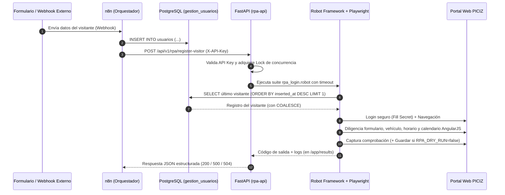

# Arquitectura Técnica — PICIZ RPA Automation Platform

## 1. Visión General

El sistema automatiza el registro de visitantes en el portal web empresarial **PICIZ** (aplicación AngularJS) eliminando la digitación manual repetitiva. Está diseñado con una arquitectura desacoplada basada en microservicios contenerizados, separando la orquestación de flujos (**n8n**), la persistencia (**PostgreSQL**), el control de ejecución HTTP (**FastAPI**) y la automatización de navegador (**Robot Framework + Playwright**).

---

## 2. Decisiones de Diseño e Ingeniería

### Separación de responsabilidades en `services/rpa-api`

- `app/config.py`: Carga centralizada y tipada de variables de entorno en una estructura `Settings` inmutable.
- `app/models.py`: Contratos HTTP estrictos en Pydantic v2 (`HealthResponse`, `RPAStatusResponse`, `RPAResponse`) con ejemplos OpenAPI listos para Swagger UI.
- `app/runner.py`: Encapsula el ciclo de vida del subproceso de Robot Framework:
  - **Control de concurrencia (`threading.Lock`):** Evita que dos peticiones simultáneas levanten múltiples instancias de Chromium procesando el mismo registro (devuelve `409 Conflict` si ya hay una ejecución activa).
  - **Protección contra bloqueos (`timeout`):** Termina ejecuciones colgadas tras `RPA_TIMEOUT_SECONDS` devolviendo `504 Gateway Timeout`.
  - **Observabilidad de estado:** Expone metadatos de la última ejecución (`running`, `last_run_at`, `last_status`, `last_returncode`) en `GET /api/v1/rpa/status`.
- `app/main.py`: Define las rutas HTTP, validación opcional de `X-API-Key` con `secrets.compare_digest` y manejo uniforme de errores.

### Modularización de Robot Framework (`robot/`)

- `robot/rpa_login.robot`: Define el flujo de alto nivel (legible como especificación de negocio) y garantiza la liberación de recursos mediante `Suite Teardown`.
- `robot/resources/keywords.resource`: Contiene los keywords técnicos desacoplados:
  - Uso de `Fill Secret` para evitar la exposición de contraseñas en `log.html` y `output.xml`.
  - Uso de `COALESCE` en SQL para prevenir valores `None` al diligenciar campos opcionales como correo, teléfono o placa.
  - Ordenamiento por `inserted_at TIMESTAMPTZ DESC` (evita inconsistencias al ordenar fechas almacenadas como texto `DD/MM/YYYY`).
  - Ajuste correcto de mes base-0 (`Number(m) - 1`) al inyectar fechas `YYYY-MM-DD` en el `Date` de AngularJS (`scope.activeDate`).
  - Interruptor `RPA_DRY_RUN` para probar de extremo a extremo de forma segura sin persistir registros reales.

### Aislamiento de red y contenedores

- Todos los servicios comparten una red bridge dedicada (`piciz_net`).
- Los puertos publicados en el host están restringidos a `127.0.0.1` por defecto (`BIND_HOST=127.0.0.1`), reduciendo la superficie de ataque.
- `ngrok` opera bajo el perfil opcional `tunnel` (`docker compose --profile tunnel up -d`) para no bloquear entornos locales sin token.
- `postgres` y `rpa-api` cuentan con `healthcheck` nativos; `n8n` y `rpa-api` esperan `condition: service_healthy` antes de arrancar.

---

## 3. Modelo de Datos (`gestion_usuarios.usuarios`)

| Columna | Tipo | Descripción |
| :--- | :--- | :--- |
| `id` | `VARCHAR(50) PK` | Identificador único del registro recibido desde n8n. |
| `nombre` | `VARCHAR(100)` | Nombre completo del visitante. |
| `email` | `VARCHAR(150)` | Correo electrónico (opcional, defecto `''`). |
| `numero_contacto` | `VARCHAR(20)` | Teléfono de contacto (opcional, defecto `''`). |
| `tipo_documento` | `VARCHAR(50)` | Tipo de documento (`CEDULA CIUDADANIA`, etc.). |
| `numero_documento` | `VARCHAR(30) UNIQUE` | Número de identificación del visitante. |
| `tiene_vehiculo` | `BOOLEAN` | Indica si ingresa con vehículo. |
| `numero_placa` | `VARCHAR(10)` | Placa del vehículo cuando `tiene_vehiculo = TRUE`. |
| `nombre_empresa` | `VARCHAR(100)` | Empresa de procedencia. |
| `puesto_cargo` | `VARCHAR(100)` | Cargo del visitante. |
| `fecha_visita` | `VARCHAR(20)` | Fecha de la visita en formato `YYYY-MM-DD`. |
| `hora_entrada` | `VARCHAR(10)` | Hora de ingreso (`HH:MM`). |
| `hora_salida` | `VARCHAR(10)` | Hora de salida (`HH:MM`). |
| `created_at` | `VARCHAR(50)` | Marca textual original enviada por integraciones externas. |
| `inserted_at` | `TIMESTAMPTZ` | Timestamp UTC real generado por PostgreSQL para ordenamiento exacto. |
