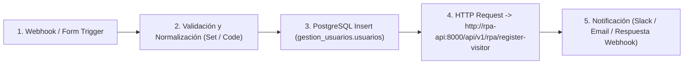

# Guía de Integración con n8n

Este documento explica cómo conectar un flujo de **n8n** con **PostgreSQL** (`gestion_usuarios`) y el microservicio **FastAPI** (`rpa-api`) dentro de la red interna de Docker (`piciz_net`).

---

## Flujo Recomendado en n8n

---

## Paso 1: Configurar Credencial de PostgreSQL en n8n

Dentro de n8n (`http://localhost:5678`), crea una credencial **Postgres** con los valores de la red interna Docker:

- **Host:** `postgres`
- **Port:** `5432`
- **Database:** `gestion_usuarios`
- **User:** valor de `POSTGRES_USER` en tu `.env`
- **Password:** valor de `POSTGRES_PASSWORD` en tu `.env`

---

## Paso 2: Insertar Visitante en PostgreSQL

Asegúrate de normalizar las fechas y horas antes de insertar:

- `fecha_visita`: formato `YYYY-MM-DD` (ejemplo: `2026-05-15`)
- `hora_entrada` / `hora_salida`: formato 24h `HH:MM` (ejemplo: `09:00`, `17:00`)
- `tiene_vehiculo`: booleano (`true` / `false`)

---

## Paso 3: Disparar el Microservicio RPA

Agrega un nodo **HTTP Request** conectado tras el nodo de PostgreSQL:

- **Method:** `POST`
- **URL:** `http://rpa-api:8000/api/v1/rpa/register-visitor`
  *(Nota: el endpoint legacy `GET http://rpa-api:8000/ejecutar-login` sigue disponible por compatibilidad).*
- **Authentication:** Generic Credential Type -> Header Auth:
  - **Name:** `X-API-Key`
  - **Value:** el mismo valor configurado en `API_KEY` dentro de `.env`
- **Timeout:** `130000` ms (ligeramente superior a `RPA_TIMEOUT_SECONDS`).

---

## Paso 4: Manejo de Respuestas

| Código HTTP | Significado | Acción sugerida en n8n |
| :---: | :--- | :--- |
| `200` | Registro automatizado exitoso | Enviar confirmación al solicitante. |
| `401` | `X-API-Key` ausente o inválida | Revisar credencial configurada en n8n. |
| `409` | Ya existe una ejecución del bot en curso | Reintentar tras esperar unos segundos (Retry on Fail). |
| `500` | Fallo durante la ejecución de Robot Framework | Revisar `error_log` y el reporte en el volumen `rpa_results`. |
| `504` | Se superó `RPA_TIMEOUT_SECONDS` | Verificar conectividad con el portal PICIZ y reintentar. |
